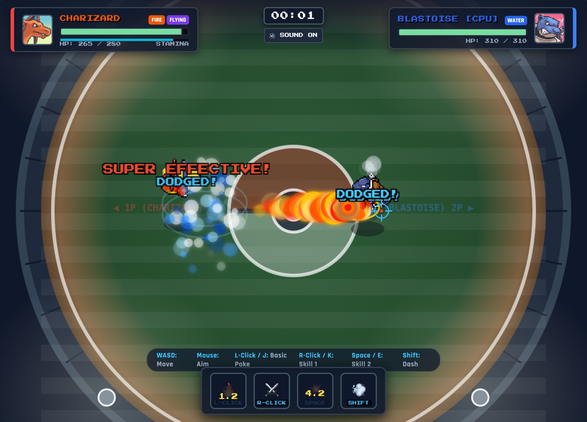
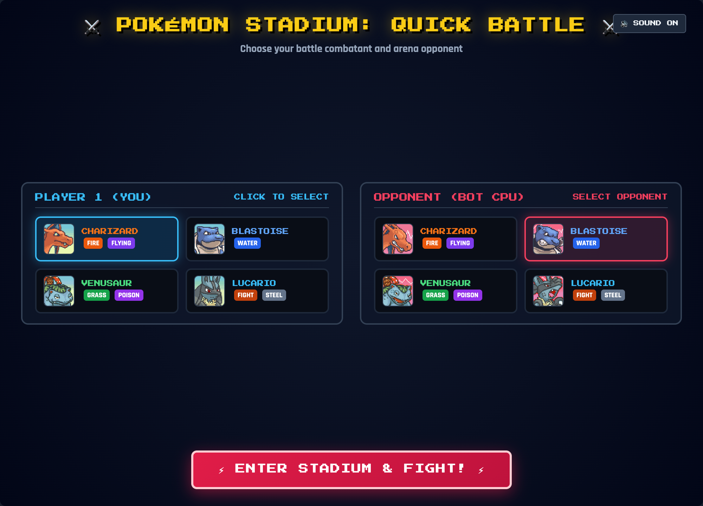
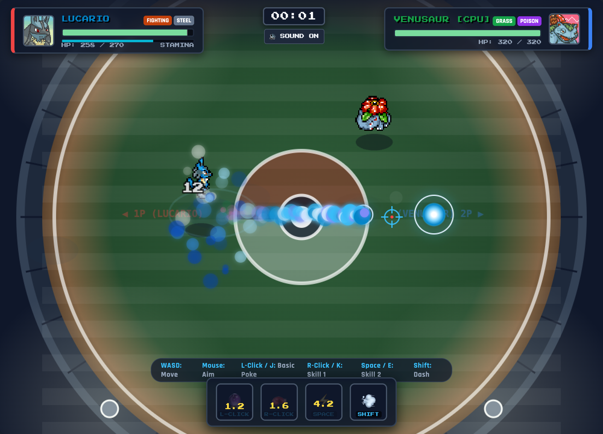
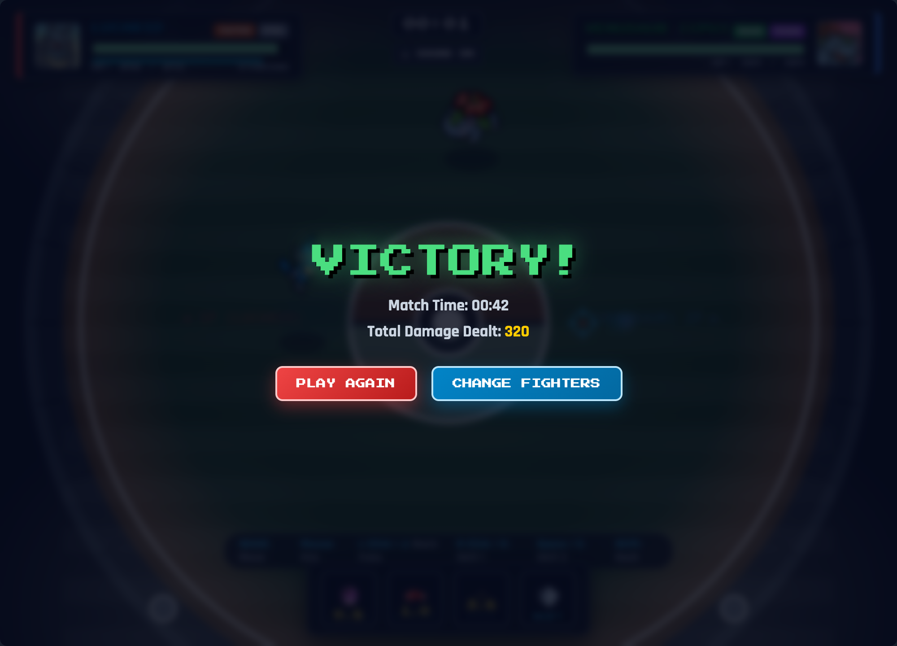

# Pokémon Stadium Arena Brawler 1v1 ⚔️

A fast-paced, real-time 2D arena combat game built with TypeScript, HTML5 Canvas, and Vite. Pick your Pokémon, face off against an AI opponent in the stadium, and battle to victory!

🎮 **Live Demo:** [https://poke1-player-game.vercel.app](https://poke1-player-game.vercel.app)

---



---

## 📸 In-Game Footage & Screenshots

<div align="center">
  <table>
    <tr>
      <td width="50%">
        <h3 align="center">⚔️ Real-Time Arena Combat</h3>
        
        <p align="center"><em>Charizard unleashing Flamethrower & Fire Blast against Blastoise</em></p>
      </td>
      <td width="50%">
        <h3 align="center">🥊 Fighter Selection Screen</h3>
        
        <p align="center"><em>Choose your combatant and CPU opponent with full stats & typing</em></p>
      </td>
    </tr>
    <tr>
      <td width="50%">
        <h3 align="center">⚡ Lucario vs Venusaur Clash</h3>
        
        <p align="center"><em>Lucario channeling Aura Sphere against Venusaur's Solar Beam</em></p>
      </td>
      <td width="50%">
        <h3 align="center">🏆 Victory & Combat Stats</h3>
        
        <p align="center"><em>Post-match battle breakdown featuring match timer & total damage dealt</em></p>
      </td>
    </tr>
  </table>
</div>

---

## ⚡ Features

- **Real-Time 1v1 Combat:** Battle against responsive AI opponents in an arena setting with full movement freedom.
- **Roster of 4 Iconic Pokémon:**
  - 🔥 **Charizard** (Fire / Flying) — *Flamethrower, Dragon Claw, Fire Blast, Wing Dash*
  - 💧 **Blastoise** (Water) — *Water Gun, Skull Bash, Hydro Pump, Rapid Spin*
  - 🌿 **Venusaur** (Grass / Poison) — *Razor Leaf, Vine Whip, Solar Beam, Petal Dash*
  - 🥋 **Lucario** (Fighting / Steel) — *Force Palm, Bone Rush, Aura Sphere, Extreme Speed*
- **Unique Movesets & Mechanics:** Dedicated basic attacks, signature skills, cooldown timers, and stamina management.
- **Visuals & Effects:** Dynamic directional sprite animations, custom particle systems (fire, water streams, leaf petals, aura energy), and impact screen shake.
- **Dynamic Sound Effects:** Procedural Web Audio API sound effects for attacks, hits, dashes, and victory fanfare.

---

## 🎮 Controls

| Action | Primary Control | Alternative |
|---|---|---|
| **Move** | `W`, `A`, `S`, `D` | Arrow Keys |
| **Aim** | `Mouse Cursor` | Towards Target |
| **Basic Attack** | `Left Click` | `J` |
| **Skill 1** | `Right Click` | `K` |
| **Skill 2** | `Space` | `E` |
| **Dash / Evade** | `Shift` | Dash in direction of movement |

---

## 🛠️ Tech Stack

- **Language:** TypeScript
- **Bundler:** Vite
- **Rendering:** HTML5 2D Canvas API
- **Audio:** Web Audio API (Synthesized SFX)

---

## 🚀 Getting Started Locally

### Prerequisites

Ensure you have [Node.js](https://nodejs.org/) installed on your machine.

### Installation

1. Clone the repository:
   ```bash
   git clone <repo-url>
   cd Pokemon
   ```

2. Install dependencies:
   ```bash
   npm install
   ```

3. Start the development server:
   ```bash
   npm run dev
   ```

4. Open the link displayed in your terminal (typically `http://localhost:5173`) in your browser.

### Build

To create an optimized production build:

```bash
npm run build
```

### Capture Screenshots

To automatically launch the headless browser and re-generate all screenshots:

```bash
npm run screenshots
```

---

## 🌐 Deployment

The project is deployed and live on Vercel:
👉 [https://poke1-player-game.vercel.app](https://poke1-player-game.vercel.app)
